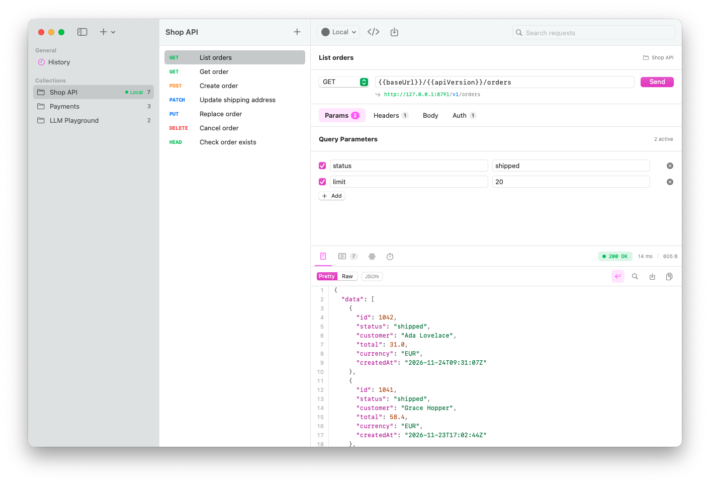

# PostWoman

A native macOS REST API client built with SwiftUI and SwiftData: a lightweight Postman alternative with collections, environments, streamed responses and code generation, which agents and scripts can drive too.

[Website](https://bearstouch.com/postwoman/) · [Download](https://github.com/bearstouch/postwoman/releases/latest) · [Changelog](CHANGELOG.md)

[](https://github.com/bearstouch/postwoman/actions/workflows/ci.yml)
[](https://github.com/bearstouch/postwoman/releases/latest)


[](LICENSE)

<picture>
  <source media="(prefers-color-scheme: dark)" srcset="Design/Screenshots/postwoman-dark.png">
  
</picture>

## Features

### Requests
- **Methods** - GET, POST, PUT, PATCH, DELETE, HEAD and OPTIONS
- **Request editor** - URL, query parameters, headers, body and authentication, each in its own tab
- **Body types** - JSON, Form Data (sent as `multipart/form-data`), URL Encoded, XML and Plain Text
- **Collections** - Requests are grouped in collections (folders). Export a collection to a file and import it on another Mac; secret values are exported empty

### Environments and variables
- Write `{{name}}` in a request's URL, params, headers, body or auth
- Every collection has a Default environment that always applies. Pick another (Local, Staging, Production…) from the toolbar, and it overrides Default only for the variables it sets
- Variables marked secret are masked in the app and left as `{{name}}` in History and generated code

### Responses
- **Body** - Formatted, syntax-highlighted JSON, or the text as received
- **Headers, Cookies and Timing** - Timing is a waterfall of DNS, connect, TLS, send, wait and download
- **Streaming** - A `text/event-stream` or NDJSON response appears as it arrives, and the Events tab lists each event with its arrival time. For LLM APIs with `"stream": true`, the Text view joins the deltas into the reply. Send becomes Stop (⌘.), which keeps what arrived

### Authentication
- **Bearer Token**
- **Basic Auth** - Username and password
- **OAuth 2.0** - The settings can be filled in and saved, but no token is requested or sent yet

### Code Generation
Export a request as code, with its variables resolved:
- **cURL** - Command-line ready
- **Swift** - URLSession
- **Python** - `requests` library

### History
- Every request sent is recorded with what was sent and what came back, including failed requests and their error
- Select an entry to read it, or open it as a new request
- Keeps the most recent 300 entries; change the limit in **Settings → General**

### Themes and updates
- Light and dark color themes, chosen in **Settings → Appearance**
- **PostWoman → Check for Updates…** installs new releases in place (Sparkle). Nothing reaches the network until you check or turn automatic checks on

### Remote Agent (MCP)
- An optional [Model Context Protocol](https://modelcontextprotocol.io) server, so agents such as Claude Code can create, update and delete collections, requests and history, and send requests
- Off by default. Turn it on in **Settings → Remote Agent**, press Apply, then use **Copy Client Setup** and the access token on the same page:

```sh
claude mcp add --transport http postwoman http://127.0.0.1:7778/mcp \
  --header "Authorization: Bearer pwm_…"
```

### Command line
- `postwoman` drives the running app through the same MCP server, from your shell or scripts. It ships inside the app; link it onto your PATH once (or use **Copy Client Setup → Command-line tool** in Settings):

```sh
/Applications/PostWoman.app/Contents/Helpers/postwoman cli install-link   # → ~/.local/bin/postwoman
postwoman collection list
postwoman request create --collection ID --name "Get user" --url https://api.example.com/users/1
postwoman request execute --id ID --include          # body on stdout, status and timing on stderr
postwoman request execute -X POST --url https://httpbin.org/post -H "Accept: application/json" -d '{"a":1}'
postwoman history list --limit 10
postwoman help                                       # every command; add --json for machine-readable output
```

- It finds the agent token and endpoint from the app itself; override with `--server` / `--agent-token` or `POSTWOMAN_URL` / `POSTWOMAN_TOKEN`. Exit statuses are stable (for example 3 for a refused token, 4 for not found, 7 when the app isn't reachable, 22 for `--fail` on a 4xx/5xx response).

## Installation

### Download (Recommended)

Download the latest DMG installer from the [Releases](../../releases) page:

1. Download `PostWoman-X.Y.Z.dmg` (Universal), or the `-apple-silicon` / `-intel` variant
2. Open the DMG file
3. Drag PostWoman to your Applications folder
4. Eject the DMG and launch PostWoman from Applications

### Build from Source

#### Requirements
- macOS 14.0 (Sonoma) or later
- Xcode 26 / Swift 6.2 toolchain (the app builds with Swift Package Manager)

#### Steps

1. Clone the repository:
   ```bash
   git clone https://github.com/bearstouch/postwoman.git
   cd postwoman
   ```

2. Build and run:
   ```bash
   swift run PostWoman            # unbundled, uses its own dev store
   scripts/run-app.sh             # sandboxed .build/PostWoman.app (com.bearstouch.postwoman.dev)
   ```
   Or open `Package.swift` in Xcode (or the folder in VS Code with the Swift extension) and run the `PostWoman` scheme.

3. Test and lint:
   ```bash
   swift test
   swift format lint --strict -r Sources Tests
   ```

#### Build DMG Installers

```bash
scripts/package-release.sh       # Universal 2 DMG in dist/ (+ dist/release-evidence.json)
scripts/package-thin-release.sh  # Apple silicon and Intel DMGs from the Universal app
```

Builds are ad-hoc signed unless `POSTWOMAN_SIGN_IDENTITY` (Developer ID) is set; set
`POSTWOMAN_NOTARY_PROFILE` (a `notarytool` keychain profile) to notarize and staple.
The version comes from `release/manifest.json`.

## Usage

### Creating a Request
1. Click **+** in the sidebar and choose **New Folder** (or **Import Collection…**)
2. Select the collection and click **New Request** (Cmd+N)
3. Enter the URL and select the HTTP method
4. Configure params, headers, body and authentication as needed
5. Press **Cmd+Return** or click **Send**

### Keyboard Shortcuts

| Action | Shortcut |
|--------|----------|
| New Request | Cmd+N |
| New Folder | Shift+Cmd+N |
| Send Request | Cmd+Return |
| Stop a streamed response | Cmd+. |
| Save Request | Cmd+S |
| Duplicate Request | Cmd+D |
| Generate Code | Shift+Cmd+G |
| Manage Environments | Cmd+E |
| Select an environment | Ctrl+1 … Ctrl+9 |

## Project Structure

```
Package.swift               # SwiftPM manifest (app, CLI and tests)
Sources/PostWoman/
├── App/                    # App entry point, root view and menu commands
├── Models/                 # SwiftData models
├── Views/
│   ├── Sidebar/           # Collections, request list and History
│   ├── RequestEditor/     # URL bar and request tabs
│   ├── ResponseViewer/    # Body, Events, Headers, Cookies, Timing
│   ├── Environments/      # Environment menu and editor
│   ├── CodeGeneration/    # Code export
│   ├── Settings/          # General, Appearance, Remote Agent, Updates
│   └── Shared/            # Reusable components
├── RemoteAgent/           # MCP server: HTTP listener, endpoint, tools
├── Services/
│   ├── HTTPClient.swift   # Networking
│   ├── AuthenticationHandler.swift
│   ├── CodeGenerator/     # cURL, Swift, Python generators
│   ├── Streaming/         # Server-sent events and NDJSON
│   ├── Variables/         # {{variable}} resolution
│   └── Updates/           # Sparkle updater
└── Utilities/             # JSON formatting, themes
Sources/PostWomanCLI/       # the postwoman command (MCP client); PostWomanCLIMain is its entry point
Tests/PostWomanTests/       # XCTest suite
release/                    # manifest.json (version, bundle id) and entitlements
scripts/                    # app bundle, DMG and release packaging
Design/                     # app icon, DMG background and README screenshots
```

## Tech Stack

- **UI Framework**: SwiftUI
- **Data Persistence**: SwiftData
- **Networking**: URLSession with async/await
- **Updates**: [Sparkle](https://sparkle-project.org)
- **Build**: Swift Package Manager, Swift 6 language mode
- **Target Platform**: macOS 14+ (Apple silicon and Intel)

## Contributing

We welcome contributions! Please see our [Contributing Guide](CONTRIBUTING.md) for details on:

- Setting up your development environment
- Our coding standards and conventions
- The pull request process

### Quick Start for Contributors

```bash
# Fork and clone
git clone https://github.com/YOUR_USERNAME/postwoman.git
cd postwoman

# Create a feature branch
git checkout -b feature/your-feature

# Make changes, then submit a PR
```

### Good First Issues

Check out issues labeled [`good first issue`](../../issues?q=is%3Aissue+is%3Aopen+label%3A%22good+first+issue%22) for beginner-friendly tasks.

## License

This project is licensed under the MIT License - see the [LICENSE](LICENSE) file for details.

## Acknowledgments

- Inspired by [Postman](https://www.postman.com/)
- Built with SwiftUI and SwiftData
